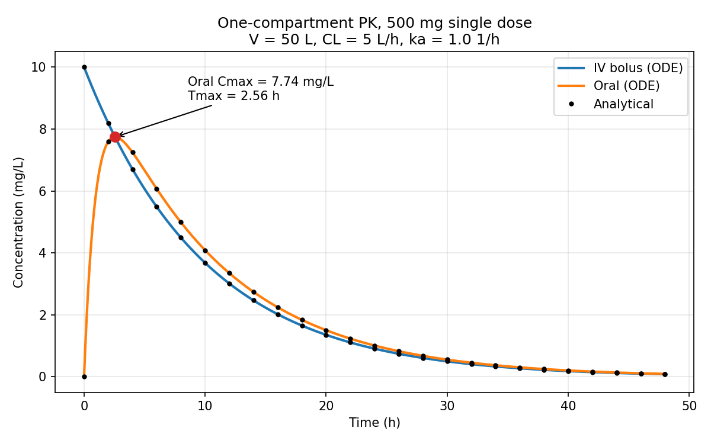
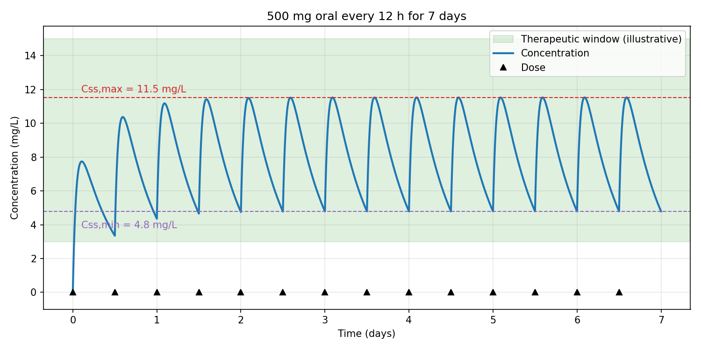
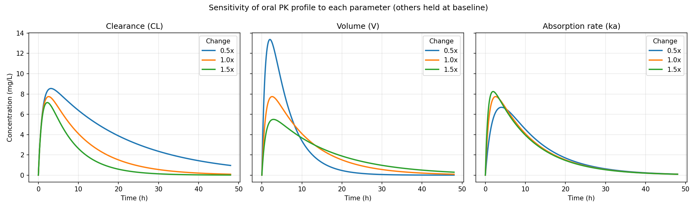

# One-Compartment Pharmacokinetic Simulation

Python simulation of a one-compartment PK model after an IV bolus and after
first-order oral absorption, solved numerically with SciPy and checked against
closed-form solutions.

> **Note:** All parameters are illustrative. They are not taken from a real drug,
> and the results should not be read as real drug PK.

## What it does

1. **Model + validation** (`pk_model.py`): IV and oral ODEs solved with
   `scipy.integrate.solve_ivp`, compared with analytical solutions.
2. **Single dose** (`plot_single_dose.py`): IV vs oral concentration-time curves.
3. **Multiple dosing** (`plot_multiple_dosing.py`): 500 mg every 12 h for 7 days,
   steady-state Cmax/Cmin against a therapeutic window.
4. **Sensitivity analysis** (`plot_sensitivity.py`): effect of clearance, volume of
   distribution and absorption rate on Cmax, Tmax, AUC and half-life.

## Model

- IV: dC/dt = -ke * C, with C(0) = Dose / V
- Oral: dA_gut/dt = -ka * A_gut, dA_central/dt = ka * A_gut - ke * A_central
- ke = CL / V, half-life = ln(2) / ke

Baseline parameters: Dose 500 mg, V = 50 L, CL = 5 L/h, ka = 1 1/h, F = 1.

## Results

| Check | Result |
|---|---|
| ke / half-life | 0.100 1/h / 6.93 h |
| Max ODE vs analytical difference (IV) | 2.26e-10 mg/L |
| Max ODE vs analytical difference (oral) | 8.43e-11 mg/L |
| Single oral dose | Cmax 7.74 mg/L at Tmax 2.56 h |
| Steady state, 500 mg q12h | Cmax 11.53 mg/L, Cmin 4.79 mg/L |
| Therapeutic window (illustrative) | 3 to 15 mg/L, steady state is inside |

### Sensitivity (each parameter varied alone, others at baseline)

| Parameter | x | Cmax | Tmax (h) | AUC | t1/2 (h) |
|---|---|---|---|---|---|
| CL | 0.5 | 8.54 | 3.15 | 200.0 | 13.86 |
| CL | 1.0 | 7.74 | 2.56 | 100.0 | 6.93 |
| CL | 1.5 | 7.15 | 2.23 | 66.7 | 4.62 |
| V | 0.5 | 13.37 | 2.01 | 100.0 | 3.47 |
| V | 1.0 | 7.74 | 2.56 | 100.0 | 6.93 |
| V | 1.5 | 5.49 | 2.90 | 100.0 | 10.40 |
| ka | 0.5 | 6.69 | 4.02 | 100.0 | 6.93 |
| ka | 1.0 | 7.74 | 2.56 | 100.0 | 6.93 |
| ka | 1.5 | 8.24 | 1.93 | 100.0 | 6.93 |

**Findings**
- AUC = F * Dose / CL, so it changes with clearance but not with V or ka.
- V changes Cmax and half-life (larger V gives lower Cmax and a longer half-life) but not AUC.
- ka only shifts the shape of the curve: faster absorption gives a higher, earlier peak.

## Plots





## Run it

```bash
pip install -r requirements.txt
python pk_model.py
python plot_single_dose.py
python plot_multiple_dosing.py
python plot_sensitivity.py
```

## Limitations

- One compartment, linear kinetics, first-order absorption, no lag time.
- Illustrative parameters and an illustrative therapeutic window.
- No inter-individual variability.